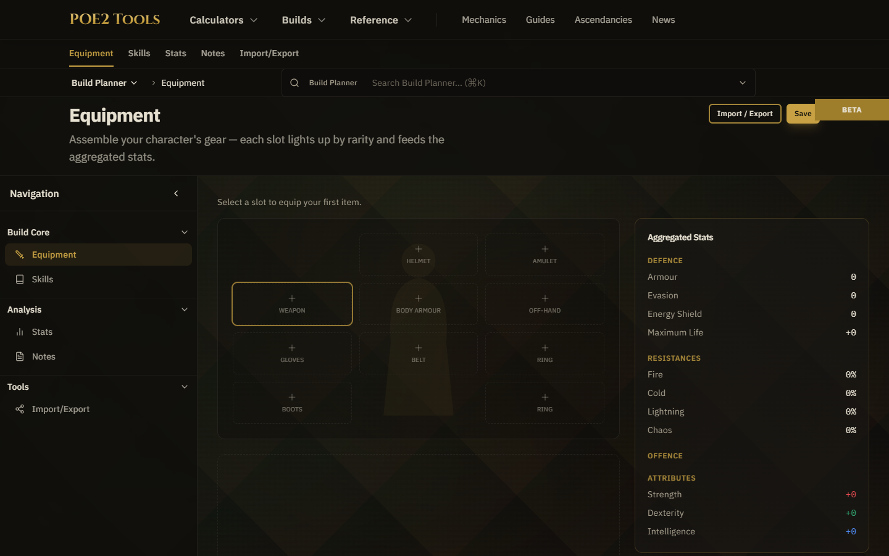
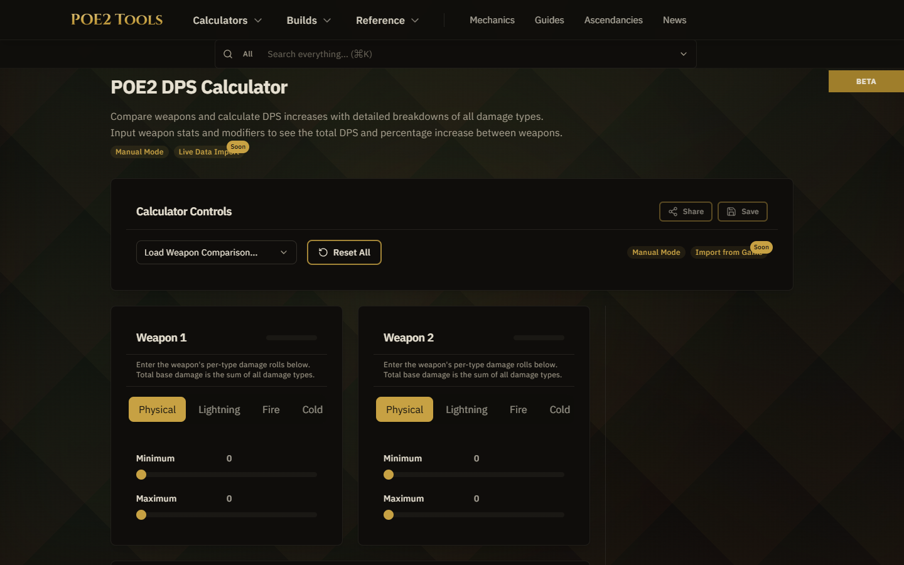
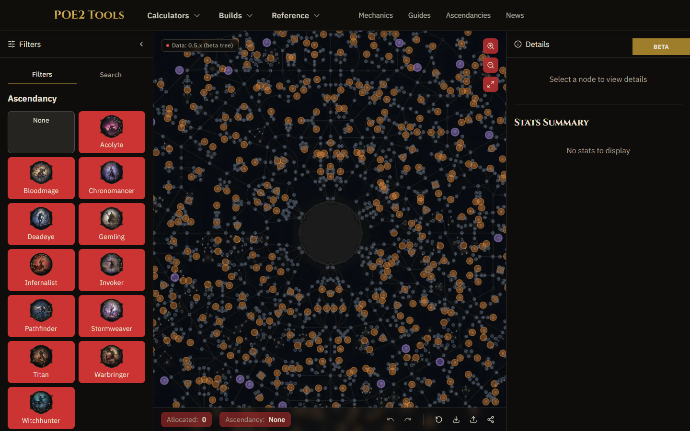

# POE2 Tools

Free, open-source Path of Exile 2 tools: build planner, DPS calculators, passive skill tree, guides and patch notes.

**Live: [www.poe2.dev](https://www.poe2.dev)**


| Build planner | DPS calculator | Passive skill tree |
| --- | --- | --- |
|  |  |  |

## Features

- Build planner with equipment, skills and passives in one place
- DPS, attack/cast speed and currency calculators
- Interactive passive skill tree with ascendancy selection and a stats summary
- Ascendancy pages, mechanics reference and guides
- Patch notes and news, with an RSS feed
- No account needed

## Tech stack

Next.js 15 (App Router), React 18, TypeScript, Tailwind CSS, Supabase, Vitest.

## Development

```bash
npm install
npm run dev
```

## Contributing

Issues and pull requests are welcome. Good places to start:

- Fix a wrong number or missing entry in the game data (gems, items, mechanics pages).
- Add or correct a guide under `src/app/guides`.
- Improve a calculator under `src/app/calculators`.
- Add a test: `npm test` runs Vitest.

Open an issue first for anything larger so we can agree on the approach.

## Support

If it helps your builds, a star helps others find it.

## Credits

- [POE2DB](https://poe2db.tw/) - Items and gem data
- [poe2-tree](https://github.com/marcoaaguiar/poe2-tree) - Skill tree knowledge and data
- [SkillTree_TypeScript](https://github.com/EmmittJ/SkillTree_TypeScript) - Skill tree implementation
- [Path of Exile Forums](https://www.pathofexile.com/forum) - Official patch notes and announcements

Unofficial fan project, not affiliated with Grinding Gear Games.
